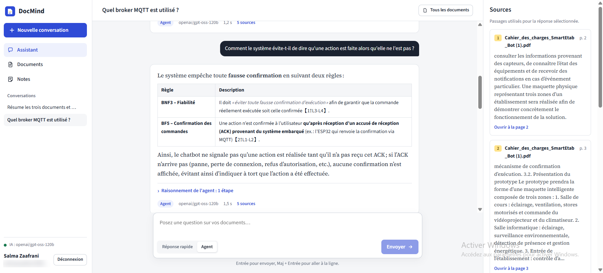
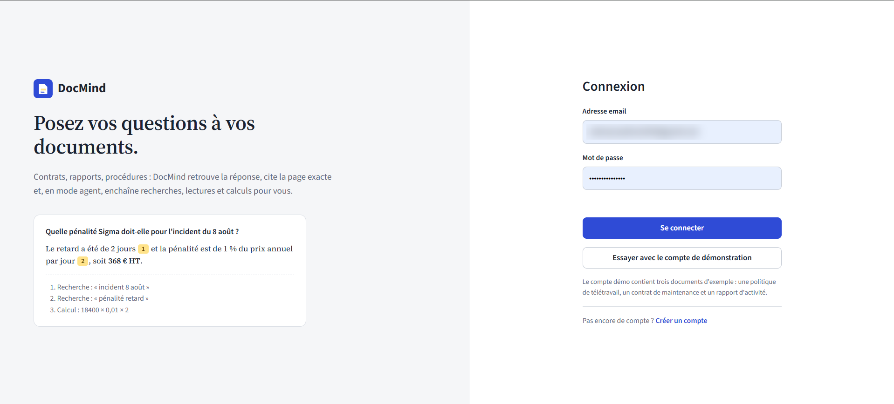
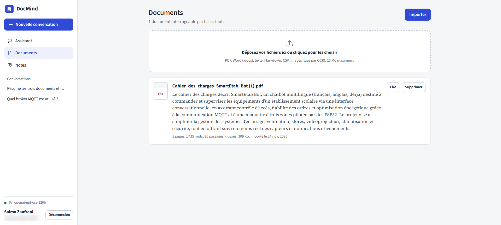

# DocMind

Assistant documentaire : posez vos questions à vos PDF, documents Word et images. Les réponses citent la page exacte, et un agent IA enchaîne recherches, lectures et calculs pour les questions complexes.



## Fonctionnalités

- **Import** de PDF, Word (.docx), texte, Markdown, CSV et images. Les pages scannées et les images sont lues par OCR (Tesseract).
- **Réponse rapide (RAG)** : recherche des passages pertinents (BM25), puis réponse rédigée par le LLM avec citations `[n]` cliquables.
- **Mode agent** : le modèle choisit lui-même ses outils et enchaîne plusieurs étapes, visibles dans l'interface.
- **Sources** : chaque citation ouvre le passage et la page du document.
- **Notes** enregistrées par l'agent, conversations sauvegardées, comptes utilisateurs (JWT).

### Outils de l'agent

| Outil | Rôle |
|---|---|
| `search_documents` | Recherche des passages, avec filtre par document |
| `list_documents` | Liste des documents et de leurs résumés |
| `read_document` | Lecture de pages complètes (résumés, comparaisons) |
| `calculate` | Calcul exact (montants, pourcentages, délais) |
| `create_note` | Enregistrement d'une synthèse dans Notes |

| Connexion | Documents |
|---|---|
|  |  |

## Stack

Spring Boot 4 (Java 21), Spring Security, JPA, PostgreSQL, PDFBox, Apache POI, Tess4J, Angular 20, Groq (API compatible OpenAI, appels d'outils), Docker.

## Lancer le projet

Prérequis : [Docker Desktop](https://www.docker.com/products/docker-desktop/).

```bash
cp .env.example .env        # Windows : copy .env.example .env
docker compose up --build
```

Ouvrir **http://localhost:4200** et cliquer sur **Essayer avec le compte de démonstration** (`demo@docmind.app` / `demo1234`). Le compte contient trois documents d'exemple.

Pour des réponses rédigées par l'IA et le mode agent, ajoutez une clé gratuite [Groq](https://console.groq.com/keys) dans `.env` (`GROQ_API_KEY=...`). Sans clé, DocMind répond avec les passages trouvés.

### Développement sans Docker

```bash
cd backend && ./mvnw spring-boot:run      # PostgreSQL local requis (base docmind)
cd frontend && npm install && npm start   # http://localhost:4200
```

## Architecture

```
Angular ──/api──▶ Spring Boot ──▶ PostgreSQL (documents, pages, passages, conversations, notes)
                      │
                      ├── Extraction : PDFBox, POI, Tesseract ──▶ découpage en passages
                      ├── Recherche : index BM25 en mémoire par utilisateur
                      └── Groq : réponse RAG ou boucle agent (appels d'outils, 6 étapes max)
```
